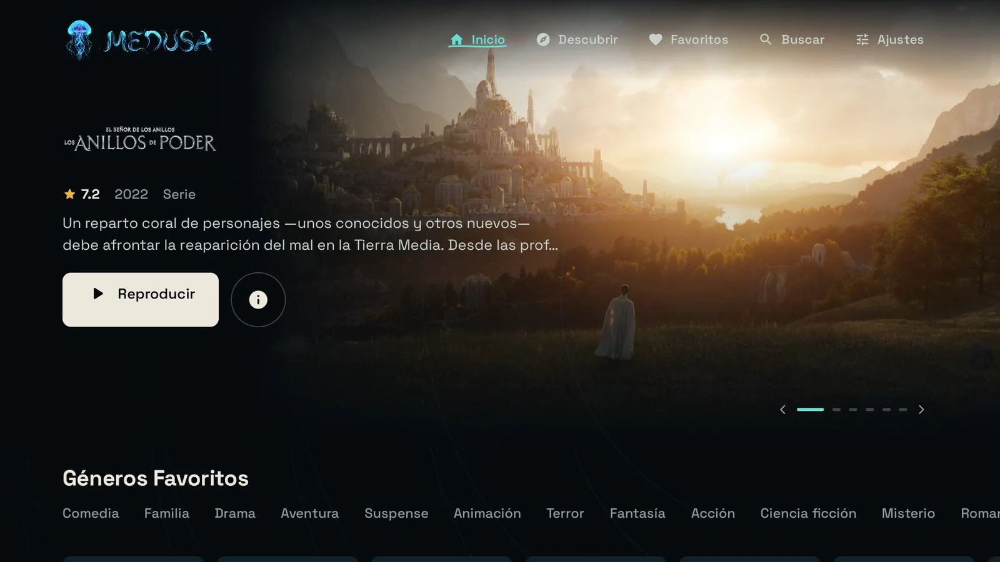
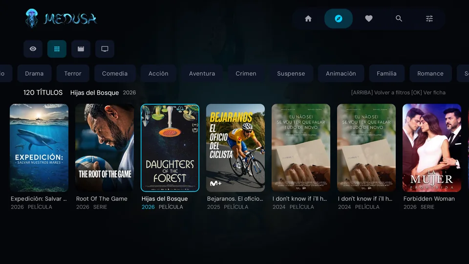
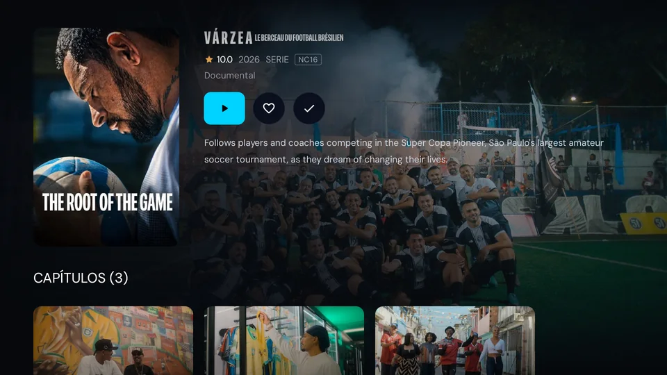
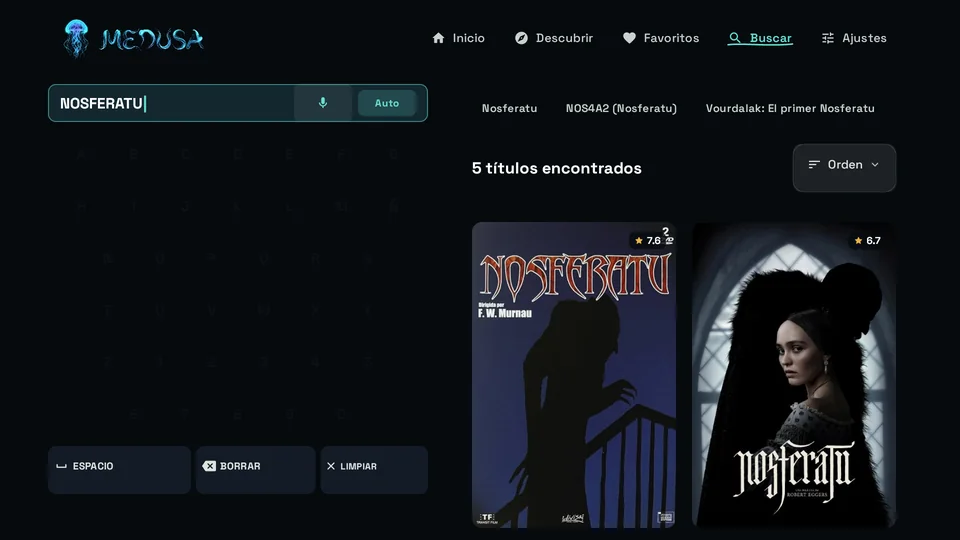

<div align="center">
  
  <p>Native Jellyfin client for Android TV and tablets, built with Kotlin and Compose TV.</p>

  [](https://github.com/GitCorion/Medusa/releases)
  [](#install)
  [](https://kotlinlang.org)
  [](https://developer.android.com/training/tv/use-apis/compose)
  [](LICENSE)

  <p>
    <a href="https://github.com/GitCorion/Medusa/releases/latest/download/Medusa.apk"><strong>Download APK</strong></a>
    &nbsp;·&nbsp;
    <a href="https://gitcorion.github.io/Medusa/"><strong>Design system</strong></a>
    &nbsp;·&nbsp;
    <a href="README.md">Español</a>
  </p>
</div>



Medusa TV is a native Jellyfin client for Android TV, Google TV, Fire TV, and
tablets. It syncs your library into a local Room database for responsive
browsing and plays media via Media3 and FFmpeg.

## Ecosystem

Medusa works standalone with any Jellyfin server. If you also use
[TOD](https://github.com/GitCorion/TOD) for on-demand `.strm` playback, the
Jellyfin companion plugin bridges both services:

| Piece | Role | When you need it |
|---|---|---|
| [Medusa](https://github.com/GitCorion/Medusa) (this repository) | Native Android TV and tablet client. Plays through Jellyfin. | Always |
| [Medusa-Jellyfin-Plugin](https://github.com/GitCorion/Medusa-Jellyfin-Plugin) | Jellyfin↔TOD bridge: status, preparation, lease, and version negotiation. | Only if using TOD |
| [TOD](https://github.com/GitCorion/TOD) | On-demand library: releases, qBittorrent queue, `.strm` generation, and range streaming. | Only for on-demand content |

```text
Medusa TV ──▶ Jellyfin ──▶ Medusa plugin ──▶ TOD :8773 ──▶ qBittorrent
                                                             ├── Prowlarr / Jackett
                                                             └── Radarr / Sonarr (API)
```

All playback requests go through Jellyfin so transcoding, subtitles, and watch
progress keep working (see [`docs/PLAYBACK.md`](docs/PLAYBACK.md)).

## Features

| Area | Details |
|---|---|
| **Home** | Hero banner with ClearLogo, favorite genres, platforms, Continue Watching, Top 10, and genre rows. |
| **Discover** | Format filters and combinable theme tags (`AND`; `BACK` removes the last filter). |
| **Search** | Remote-friendly on-screen keyboard, local suggestions, and remote Jellyfin search. |
| **Detail** | Poster, metadata, synopsis, watched/favorite state, seasons and episodes, collections, and recommendations. |
| **Player** | Media3 + FFmpeg: DirectPlay, remux, HLS, transcoding, `.strm`, TOD preparation, subtitles, audio tracks, HDMI passthrough, Media Segments, and auto refresh-rate switching. |
| **Library & integrations** | Room local cache, parental filters, incremental sync, Trakt, TMDB (user API key), and OTA updates from GitHub Releases. |
| **Customization** | Accent colors, monochrome mode, button styles, optional particles, subtitle size/background, and reduced motion. |

## Screenshots

<p align="center">
  
  
</p>
<p align="center">
  
  
</p>

## Install

Requires **Android 8.0+ (API 26)** and a reachable Jellyfin server (HTTP/HTTPS,
LAN, subpath, or self-signed certificate with SHA-256 pinning).

- **APK:** download `Medusa.apk` from [GitHub Releases](https://github.com/GitCorion/Medusa/releases/latest) and install on the device or via ADB:
  ```bash
  adb install -r Medusa.apk
  ```
- **Sign in:** under **Settings**, pick the discovered server (or enter its URL) and sign in with credentials or **Quick Connect**.
- **OTA updates:** checks GitHub Releases on startup with SHA-256 verification; switch between **stable** and **beta** in **Settings → About → Channel**.

## Build

Requires **JDK 17** and **Android SDK 36**.

```bash
git clone https://github.com/GitCorion/Medusa.git
cd Medusa
./gradlew :app:assembleDebug          # APK at app/build/outputs/apk/debug/app-debug.apk
./gradlew :app:testDebugUnitTest      # Unit tests
./gradlew :app:lintDebug              # Lint
```

For signed release builds (`assembleRelease`), pass `KEYSTORE_PATH`,
`KEYSTORE_PASSWORD`, `KEY_ALIAS`, and `KEY_PASSWORD` via environment variables
or `keystore.properties` (see [`docs/RELEASE.md`](docs/RELEASE.md)).

## Documentation

| Document | Contents |
|---|---|
| [`docs/ARCHITECTURE.md`](docs/ARCHITECTURE.md) | Layers, repositories, Room, workers, and tests |
| [`docs/PLAYBACK.md`](docs/PLAYBACK.md) | Playback candidates, `DeviceProfile`, audio, and subtitles |
| [`docs/RELEASE.md`](docs/RELEASE.md) | GitHub Releases publishing, OTA, and signing |
| [`docs/ESTUDIO.md`](docs/ESTUDIO.md) / [`DESIGN.md`](DESIGN.md) | Visual system, tokens, and UI decisions |
| [`docs/CATALOGS.md`](docs/CATALOGS.md) | Static regional discovery catalogs |
| [`CONTRIBUTING.md`](CONTRIBUTING.md) | Contribution guide and commit conventions |
| [`SECURITY.md`](SECURITY.md) | Security policy and vulnerability reporting |
| [`CHANGELOG.md`](CHANGELOG.md) | Changelog |

## Troubleshooting

| Symptom | Check |
|---|---|
| Server not found | Ensure device and server are on the same network without firewall blocks; enter the URL manually. |
| Certificate error | Enable self-signed certificates for that server and pin its SHA-256 fingerprint. |
| `.strm` fails to start | Ensure the TV is not trying to reach an internal server IP (see [`docs/PLAYBACK.md`](docs/PLAYBACK.md)). |
| No DTS/TrueHD audio | Enable HDMI passthrough if supported by your receiver, or let Jellyfin transcode. |
| Missing subtitles | Verify the track exists in `MediaSource` and the subtitle endpoint responds. |

## License

**GNU General Public License v3.0** ([`LICENSE`](LICENSE)).
*This product uses the TMDB API but is not endorsed or certified by TMDB.*
DM Sans is distributed under the SIL Open Font License.
