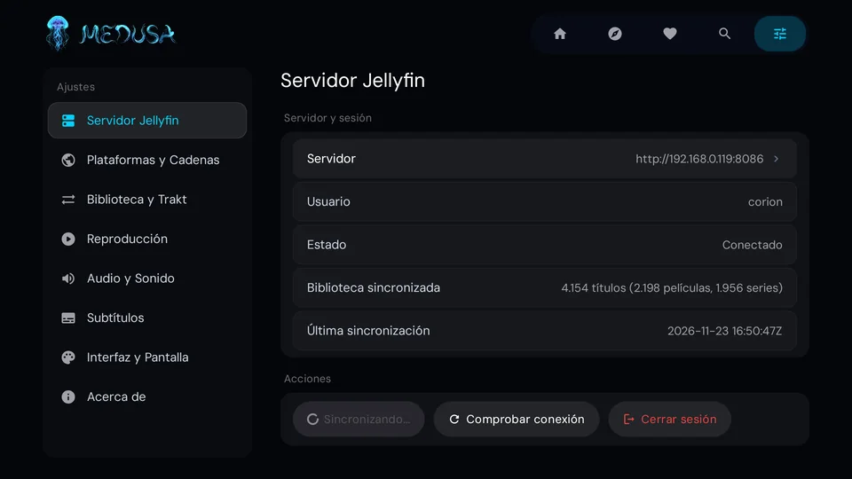
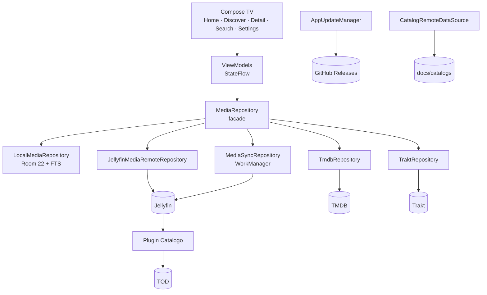

<div align="center">
  
  <p><strong>Your Jellyfin library, three meters away.</strong><br>
  A native Android TV and tablet client built with Kotlin and Compose TV.<br>
  No webviews, no Firebase, no analytics, no Play Store.</p>

  [](https://github.com/GitCorion/Medusa/releases)
  [](#requirements)
  [](https://kotlinlang.org)
  [](https://developer.android.com/training/tv/use-apis/compose)
  [](LICENSE)

  <p>
    <a href="https://github.com/GitCorion/Medusa/releases/latest/download/Medusa.apk"><strong>Download the APK</strong></a>
    &nbsp;·&nbsp;
    <a href="https://gitcorion.github.io/Medusa/"><strong>Design study</strong></a>
    &nbsp;·&nbsp;
    <a href="README.md">Español</a>
  </p>
</div>


<p align="center"><sub>Home on a 1080p television.</sub></p>

## What it is

Medusa TV is a native Jellyfin client for the living room. It turns your self-hosted library into a ten-foot interface built for a couch, a five-key remote and an OLED screen: full-bleed artwork, high-contrast focus and no chrome competing with the content.

It is not a web wrapper and it does not host a catalog. The app talks directly to **your** Jellyfin server, stores the catalog on the device and only reaches the internet for metadata, discovery catalogs, Trakt (if you link it) and signed updates from GitHub Releases.

## Ecosystem

Medusa is the client piece. The other two are optional and only needed if you want catalog-on-demand playback.

| Piece | Role | When you need it |
|---|---|---|
| [Medusa](https://github.com/GitCorion/Medusa) (this repository) | Native Android TV and tablet client. Plays through Jellyfin. | Always |
| [Medusa-Jellyfin-Plugin](https://github.com/GitCorion/Medusa-Jellyfin-Plugin) | Jellyfin plugin (C#) exposing status, preparation and playback leases. Maps a `.strm` item to a TOD key. It appears in Jellyfin as **Catalogo**. | If you use TOD |
| [TOD](https://github.com/GitCorion/TOD) | Python catalog-on-demand service: finds sources, downloads with qBittorrent, generates the `.strm` files and streams by byte ranges. It also talks to Prowlarr/Jackett and, optionally, Radarr/Sonarr. | If you want to prepare and play content that is not downloaded |

```text
Medusa TV ──▶ Jellyfin ──▶ Catalogo plugin ──▶ TOD :8773 ──▶ qBittorrent
                                                             ├── Prowlarr / Jackett
                                                             └── Radarr / Sonarr (API)
```

Medusa **never talks to TOD directly**. It talks to Jellyfin; the plugin translates the conversation. The client never uses the proxy `play` URL: it plays through Jellyfin so transcoding, subtitles and watch progress keep working.

### How Medusa fits

1. Medusa requests `PlaybackInfo` for the item from Jellyfin.
2. If the `MediaSource` path ends in `.strm`, it queries the plugin: `GET /Catalogo/Status/{itemId}`.
3. If it is a catalog item and `stream_ready` is false, it calls `POST /Catalogo/Prepare/{itemId}`, shows a buffer and polls every 1–2 seconds.
4. When `stream_ready` is true, it plays through Jellyfin's normal playback. The plugin keeps a lease to follow the session if TOD switches source.
5. If the plugin is not installed or the item is not a catalog item, it plays like any other Jellyfin item.

Bridge requirements: Jellyfin 12.4 or newer, the plugin installed from its manifest and a TOD proxy reachable from Jellyfin, usually on loopback (`http://127.0.0.1:8773`). TOD is in active beta; its UI and API may change between minor versions.

Without the plugin, `.strm` items remain normal Jellyfin items: they play if already prepared, but there is no on-demand preparation or progress from the app.

## Design and behavior

- **Focus and navigation.** An 18 dp icon dock. Focus is carried by a 1.5 dp border on the poster, `zIndex(10f)` and the title at full brightness. Neighbouring cards keep their opacity: no spotlight and no scaling. The physical BACK key is the way back on TV.
- **Performance.** `Modifier.blur()` and `RenderEffect` are banned. Cards neither scale nor dim their siblings, and there are no autonomous animations; motion only exists when the remote acts. The target is 60 fps on entry-level hardware.
- **Type and color.** DM Sans across the interface, abyss ink `#04060A`, focus cyan `#00D2FF`, cobalt/aqua and amber/gold for ratings. Tokens live in `ui/theme/Color.kt` and `DESIGN.md`; no decorative serif in the UI.
- **Privacy.** No Firebase, no analytics, no ads and no advertising ID. Credentials are encrypted with AES/GCM and the Android Keystore; there are no Medusa user servers.

## Features

| Area | What is included |
|---|---|
| **Home** | Full-bleed hero with ClearLogo, favorite genres, platform tiles, Continue watching with progress, Top 10 and genre carousels. Scrim, pagination and one primary action. |
| **Navigation** | 18 dp icon dock: focus does not require OK. The bar supports icons, text or both, and BACK remains the way back. |
| **Discover** | Format filters (all, catalog, movies, series), theme rail and live results. Result count and remote shortcuts. |
| **Search** | Ten-foot on-screen keyboard with predictive suggestions, instant results and remote Jellyfin search. |
| **Detail** | Poster, editorial metadata, container-free synopsis, progress/favorite states, seasons and episodes, saga titles and recommendations. |
| **Player** | Media3 + FFmpeg. DirectPlay, remux, HLS and transcoding; `.strm`; TOD preparation with the plugin; subtitles; audio tracks; HDMI passthrough; next episode; intro, recap and preview skipping via Media Segments; automatic refresh-rate switching. |
| **Library** | Room with full-text search, local cache, parental access filters, collections and sagas, incremental background sync. |
| **Personalization** | Accent themes (bioluminescent cyan, cinema amber, pure white), monochrome mode, button styles, particles, navigation sounds, theme songs, subtitle size and background, reduced motion. |
| **Integrations** | Jellyfin with LAN discovery, manual URL, subpaths, IPv6, pinned self-signed certificates and Quick Connect. TOD with the [Catalogo plugin](https://github.com/GitCorion/Medusa-Jellyfin-Plugin). Trakt via device code. TMDB with your own key. Static regional catalogs. OTA from GitHub Releases. |

## Installation

### Requirements

- Android 8.0 or newer (API 26). Android TV, Google TV, Fire TV or tablet.
- A Jellyfin server reachable from the device, on the local network or over the internet.
- 15 MB of free space. No Medusa account and no Google services required.

### Download the APK

1. Open [the latest release](https://github.com/GitCorion/Medusa/releases/latest) in the TV browser, or download the APK on your phone and send it to the device.
2. Allow apps from unknown sources for the browser or receiver you use.
3. Open `Medusa.apk` and install.

You can also sideload it with ADB:

```bash
adb install -r Medusa.apk
adb shell am start -n tv.medusa.app/tv.medusa.app.MainActivity
```

> The `applicationId` is `tv.medusa.app` from 2.4.0. The published 2.3.12 APK still uses `tv.medusa.app.beta`: if you come from it, install the new build and uninstall the old one once. Android treats them as different apps and settings are not migrated.

### Updates

The app reads the [`docs/api/version.json`](docs/api/version.json) manifest on startup. When a new version exists, it downloads `Medusa.apk` from the GitHub Release, verifies the **SHA-256**, the maximum size and that the origin is GitHub, then launches the system installer. If the manifest cannot be verified for seven days, the app **fails closed** instead of running an unverified version. The manifest supports forced updates and a global kill switch.

There are two channels: **stable** (`latest` Releases) and **beta** (pre-releases with their own manifest). You join beta by installing its APK once; the next stable brings the device back to the stable channel. Details in [`docs/RELEASE.md`](docs/RELEASE.md).

## First run

1. **Server.** Medusa looks for Jellyfin on the local network. If it does not appear, enter the full URL, including a subpath such as `https://host/jellyfin`. For a self-signed certificate, enable it explicitly and pin its SHA-256.
2. **Sign in.** Use a username and password, or **Quick Connect**: the TV shows a code and you authorize it from Jellyfin on your phone.
3. **Sync.** The first pass downloads the catalog into Room. Later passes are incremental and run in the background with WorkManager.
4. **Discovery.** Pick your region and the platforms you want to cross-reference with your library. The TMDB key is optional and stays on the device; Trakt is optional too.
5. **Done.** Home, Discover and Search now work against your local catalog, even if the server is slow to respond.

## Screenshots

<p align="center">
  
  
</p>
<p align="center">
  
  
</p>

<p align="center"><sub>Real captures from the app on a 1080p television. The top bar supports icons only, text only or both; the captures use icons only. <a href="https://gitcorion.github.io/Medusa/#pantallas">See all seven screens and the design decisions behind them</a>.</sub></p>

## Architecture

One activity, Navigation Compose and one state per screen. The single entry point to data is a thin facade, `MediaRepository`, which composes specialized repositories instead of concentrating all logic in one giant class.



The decisions behind it:

- **Specialized repositories.** Local, remote Jellyfin, sync, TMDB, Trakt, access policy and TTL caches. The facade keeps a stable public API for ViewModels and workers.
- **Room 22 with FTS.** Catalog, artwork caches, collections and seasonal indexes live on the device. Migrations are covered by an instrumented test.
- **Encrypted credentials.** AES/GCM with an Android Keystore key. If the Keystore fails, the write fails; a token is never stored in plain text.
- **Cascading playback.** `.strm` resolved on the server, remux, DirectStream, transcode and full transcoding. The device profile is serialized with `encodeDefaults = true` and verified by a golden test.
- **Bounded background work.** Sync, collection indexing and synopsis enrichment run in separate workers with bounded concurrency and pause while the app is in the foreground.
- **Performance measured on a TV.** Baseline Profile, zero blur, TV components and a 1.5 dp focus border. Zero per-card scaling.

Full detail on layers, flows and tests is in [`docs/ARCHITECTURE.md`](docs/ARCHITECTURE.md). The playback invariants that must not be broken are in [`docs/PLAYBACK.md`](docs/PLAYBACK.md).

## Build

### Requirements

- JDK 17.
- Android SDK 36 (`compileSdk = 36`, `targetSdk = 36`).
- A recent Android Studio, or Gradle from the terminal.

```bash
git clone https://github.com/GitCorion/Medusa.git
cd Medusa
./gradlew :app:assembleDebug
```

The debug APK is written to `app/build/outputs/apk/debug/app-debug.apk`.

### Tests and lint

```bash
./gradlew :app:testDebugUnitTest
./gradlew :app:lintDebug
./gradlew :app:connectedDebugAndroidTest   # Room migrations, requires a device
```

### Build a signed release

Keys are not versioned. Use environment variables or a local `keystore.properties`:

```bash
KEYSTORE_PATH=/path/to/release.keystore \
KEYSTORE_PASSWORD=... \
KEY_ALIAS=... \
KEY_PASSWORD=... \
./gradlew :app:assembleRelease
```

Optional variables: `TRAKT_CLIENT_ID` and `TRAKT_CLIENT_SECRET`. The TMDB key is **not** embedded: each user enters their own in Settings.

### Publish

[`release.yml`](.github/workflows/release.yml) runs on a `v*` tag or manually. It runs tests, builds the signed APK, creates the Release with a `Medusa.apk` asset and updates the OTA manifest. Required secrets and the complete process are in [`docs/RELEASE.md`](docs/RELEASE.md).

## Project layout

```text
app/src/main/java/tv/medusa/app/
├── ui/                  Compose TV: screens, components, theme, abyssal identity
│   ├── screens/         Home, Medusa (Discover), Favorites, Search, Detail, Genre,
│   │                    Brand, Seasonal, Settings, Onboarding, Player
│   ├── components/      Cards, rows, top bar, hero, keyboard, trailer, menus
│   └── theme/           Color.kt, Type.kt, TvDesignSystem.kt, WindowSize.kt
├── data/
│   ├── local/           DataStore, snapshots, Room 22 and DAOs
│   ├── remote/          Jellyfin, TMDB, Trakt, catalogs, OTA, networking
│   ├── repository/      MediaRepository and collaborators
│   └── worker/          Sync, collections and enrichment
├── domain/              Models and use cases
├── di/                  Hilt graph
├── util/                Crypto, images, audio, AFR, player, TV channels
└── MainActivity.kt      Navigation, remote input and updates
```

## Documentation

| Document | Purpose |
|---|---|
| [Design study](https://gitcorion.github.io/Medusa/) | The visual story of the product, with a focus demo, system, screens and decision log. |
| [`docs/ESTUDIO.md`](docs/ESTUDIO.md) | The same study in Markdown, for offline reading and citation. |
| [`DESIGN.md`](DESIGN.md) | Tokens, typography, structure, motion and Do/Don't rules. |
| [`PRODUCT.md`](PRODUCT.md) | Users, purpose, positioning and product constraints. |
| [`docs/ARCHITECTURE.md`](docs/ARCHITECTURE.md) | Layers, flows, caches, workers, tests and technical decisions. |
| [`docs/PLAYBACK.md`](docs/PLAYBACK.md) | Candidate order, device profile, audio, subtitles and mistakes not to repeat. |
| [`docs/RELEASE.md`](docs/RELEASE.md) | GitHub Releases distribution, OTA, signing and secrets. |
| [`docs/CATALOGS.md`](docs/CATALOGS.md) | Regional discovery catalogs and the nightly workflow. |
| [`CONTRIBUTING.md`](CONTRIBUTING.md) | Environment, style, tests and PR checklist. |
| [`SECURITY.md`](SECURITY.md) | How to report a vulnerability and what the app guarantees. |
| [`CHANGELOG.md`](CHANGELOG.md) | Current release changes and a link to the release history. |

<details>
<summary>Historical documentation for the former Play Store plan</summary>

[`docs/PLAN_PLAY_STORE.md`](docs/PLAN_PLAY_STORE.md), [`docs/PLAY_CONSOLE_SETUP.md`](docs/PLAY_CONSOLE_SETUP.md), [`docs/PLAY_STORE_METADATA.md`](docs/PLAY_STORE_METADATA.md) and [`docs/PLAN_MEDUSA_PROFESIONAL.md`](docs/PLAN_MEDUSA_PROFESIONAL.md) describe an earlier stage. Distribution today is a signed APK on GitHub Releases.

</details>

## Privacy and security

Medusa does not collect data, show ads or include third-party analytics or crash reporting. The Advertising ID permission is explicitly removed from the manifest.

| Destination | When | What travels |
|---|---|---|
| Your Jellyfin server | Always | Credentials, catalog, images, playback and progress. It is your server. |
| Your Jellyfin server + Catalogo plugin / TOD | If you use TOD | Item status, preparation and lease. Video is served by your Jellyfin. |
| `raw.githubusercontent.com/GitCorion/Medusa` | Startup and discovery | OTA manifest, static catalogs and the tag dictionary. No personal data. |
| `api.themoviedb.org` / `image.tmdb.org` | If you configure a TMDB key | Metadata queries and posters. The key is yours and stored encrypted. |
| `api.trakt.tv` | If you link Trakt | Watch history, lists and collections, under Trakt's terms. |
| `youtube-nocookie.com` | If you open a trailer | The embedded trailer playback. |

- **QR:** codes are generated on the device itself; the text being encoded (server URL or QuickConnect code) is never sent to an external service.

- **TOD and the plugin:** they run on your server; Medusa talks to them through Jellyfin. There is no Medusa service in between.
- **Credentials:** AES/GCM with an Android Keystore key, hardware-backed where available. They are never written in plain text.
- **TLS:** HTTP and HTTPS on any host. Self-signed certificates require explicit opt-in and a SHA-256 pin; user-installed CAs are not accepted.
- **OTA:** origin restricted to GitHub, 150 MB size cap, mandatory SHA-256, seven-day manifest expiry and a global kill switch.
- **Content:** Medusa is a player. It does not host, distribute or sell content. You are responsible for your library.

To report a vulnerability, follow [`SECURITY.md`](SECURITY.md). Do not open a public issue with tokens, passwords, private IPs or server screenshots.

## Troubleshooting

| Symptom | What to try |
|---|---|
| Server not found | Check that both devices are on the same network, Jellyfin listens on the right interface and the firewall allows discovery. Enter the URL manually. |
| Certificate error | For a self-signed certificate, enable it per server and pin the SHA-256. An expired certificate also fails. |
| A `.strm` will not start | The TV must never try the internal IP of the file. Check that Jellyfin resolves the target and read [`docs/PLAYBACK.md`](docs/PLAYBACK.md). |
| DTS/TrueHD is silent | Enable HDMI passthrough if your receiver supports it, or let Jellyfin transcode. There is no software DTS/TrueHD decoding. |
| Subtitles do not appear | Check the server subtitle endpoint and that the track exists in the MediaSource. |
| Update does not appear | Verify that `versionCode` is higher, the manifest is current and the APK is the `Medusa.apk` asset in the release. |
| UI stutters | Disable particles and ambient sounds, check the system reduced-motion setting and avoid servers forcing 4K transcoding. |

If none of that helps, open an [issue](https://github.com/GitCorion/Medusa/issues) with device model, Android version, app version, Jellyfin version and a description of the flow. Never include tokens or credentials.

## Contributing

Contributions are welcome, especially when they come with a test that describes the bug. Before opening a PR:

1. Read [`CONTRIBUTING.md`](CONTRIBUTING.md).
2. Run `./gradlew :app:testDebugUnitTest` and `./gradlew :app:lintDebug`.
3. Do not break the playback invariants in [`docs/PLAYBACK.md`](docs/PLAYBACK.md).
4. Keep both translations in sync (`values/strings.xml` and `values-en/strings.xml`).
5. Respect the visual rules: zero blur, zero per-card scaling inside carousels, one active focus.

Commits follow a conventional style in Spanish, for example `fix(player): reintentar audio sin perder la posición`.

## Credits

- [Jellyfin](https://jellyfin.org): the server and the reason this client exists.
- [Medusa-Jellyfin-Plugin](https://github.com/GitCorion/Medusa-Jellyfin-Plugin): GPL-3.0 bridge between Jellyfin and TOD.
- [TOD](https://github.com/GitCorion/TOD): MIT catalog-on-demand engine.
- [TMDB](https://www.themoviedb.org): metadata and posters. *This product uses the TMDB API but is not endorsed or certified by TMDB.*
- [Trakt](https://trakt.tv): scrobbling, lists and collections.
- [Android Media3](https://developer.android.com/media/media3): playback and media session.
- [Kotlin](https://kotlinlang.org), [Jetpack Compose](https://developer.android.com/compose), [Hilt](https://dagger.dev/hilt/), [Room](https://developer.android.com/training/data-storage/room), [Coil](https://coil-kt.github.io/coil/), [Retrofit](https://square.github.io/retrofit/), [OkHttp](https://square.github.io/okhttp/) and [WorkManager](https://developer.android.com/topic/libraries/architecture/workmanager).
- [DM Sans](https://github.com/googlefonts/dm-fonts), under the SIL Open Font License.
- *Night of the Living Dead* (1968) poster: public domain. All other posters and captures belong to their respective owners and are shown for documentation purposes.

## License

Medusa TV is distributed under the **GNU General Public License v3.0**. See [`LICENSE`](LICENSE).

Medusa is an independent client and is not affiliated with or endorsed by Jellyfin, TMDB or Trakt. Jellyfin is a trademark of its owners. The Catalogo plugin is distributed under GPL-3.0 and TOD under MIT, each in its own repository.

<div align="center">
  <p><strong>Built for Jellyfin. No cloud, no Medusa account, no tracking what you watch.</strong></p>
</div>
