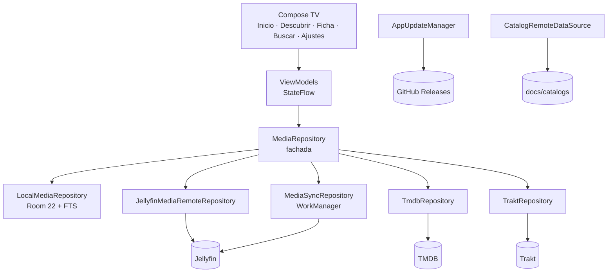

<div align="center">
  
  <p><strong>Tu biblioteca Jellyfin, a tres metros.</strong><br>
  Cliente nativo para Android TV y tablet, escrito en Kotlin y Compose TV.<br>
  Sin webviews, sin Firebase, sin analítica y sin Play Store.</p>

  [](https://github.com/GitCorion/Medusa/releases)
  [](#requisitos)
  [](https://kotlinlang.org)
  [](https://developer.android.com/training/tv/use-apis/compose)
  [](LICENSE)

  <p>
    <a href="https://github.com/GitCorion/Medusa/releases/latest/download/Medusa.apk"><strong>Descargar el APK</strong></a>
    &nbsp;·&nbsp;
    <a href="https://gitcorion.github.io/Medusa/"><strong>Estudio de diseño</strong></a>
    &nbsp;·&nbsp;
    <a href="README.en.md">English</a>
  </p>
</div>


<p align="center"><sub>Inicio en un televisor de 1920 × 1080. Las capturas reflejan la capa visual de <code>main</code>; el APK publicado 2.3.12 aún no incluye esta pasada.</sub></p>

## Qué es

Medusa TV es un cliente Jellyfin nativo para el salón. Convierte tu biblioteca autoalojada en una interfaz de diez pies pensada para un sofá, un mando de cinco teclas y una pantalla OLED: arte a sangre, una sola luz de foco y cero adornos que compitan con el contenido.

No es un envoltorio web ni un catálogo alojado. La app habla directamente con **tu** servidor Jellyfin, guarda el catálogo en local y solo sale a internet para los metadatos, los catálogos de descubrimiento, Trakt (si lo vinculas) y las actualizaciones firmadas de GitHub Releases.

**En este repositorio:** más de 140 archivos Kotlin, 36 pruebas unitarias, una prueba de migración, 13 regiones de catálogo y una identidad visual propia que puedes recorrer en el [estudio publicado](https://gitcorion.github.io/Medusa/).

## Catálogo bajo demanda (TOD)

Medusa reproduce lo que Jellyfin tiene en su biblioteca. Si además usas
[TOD](https://github.com/GitCorion/TOD), el plugin
[Medusa-Jellyfin-Plugin](https://github.com/GitCorion/Medusa-Jellyfin-Plugin)
convierte los ítems `.strm` del catálogo bajo demanda en algo que la tele
entiende:

- Medusa pide `Prepare` al plugin cuando el ítem aún no está listo.
- El plugin traduce el ítem de Jellyfin a una clave de TOD y consulta `/status`.
- Medusa muestra el buffer y reproduce cuando `stream_ready` es verdadero.
- Si TOD cambia de fuente, el plugin expone `stream_generation` y Medusa
  reinicia la reproducción sin salir de la ficha.

Sin el plugin, los `.strm` siguen siendo ítems de Jellyfin normales: se pueden
reproducir si ya están preparados, pero no hay progreso ni preparación desde la
app.

## Lo que hace diferente

- **Foco a tres metros.** La navegación usa tabs pill de Material TV y el foco sobre una tab cambia de destino sin exigir OK. Las tarjetas de carrusel llevan borde de 3 dp; botones, tabs y controles aislados escalan 1,1x. El título pasa de sedimento a pergamino.
- **60 fps por decisión.** `Modifier.blur()` y `RenderEffect` están prohibidos. Las tarjetas dentro de un carrusel no escalan ni atenúan a sus vecinas; el movimiento existe solo cuando el mando actúa. Cero animaciones autónomas.
- **Piel abisal sobre Material TV.** Tinta abisal, corriente turquesa, violeta de medusa, ámbar de valoración y Space Grotesk como única voz. La identidad vive en la paleta, el emblema y el arte; el comportamiento (tabs, foco, overscan) es el de la plataforma.
- **Privacidad por arquitectura.** Sin Firebase, sin analítica, sin publicidad, sin ID de publicidad. Las credenciales se cifran con AES/GCM y Android Keystore. La app no tiene servidores propios de usuario.

## Funciones

| Área | Qué incluye |
|---|---|
| **Inicio** | Hero a sangre con ClearLogo, géneros favoritos, placas de plataformas, Continuar viendo con progreso, Top 10 y carruseles por género. Scrim, paginación y una sola acción primaria. |
| **Navegación** | Tabs pill de Material TV: el foco sobre una tab cambia de destino sin exigir OK. La barra admite iconos, texto o ambos. Overscan de 58/28 dp y objetivos de 48 dp. |
| **Descubrir** | Filtros de formato (todo, catálogo, películas, series), rail de temáticas y resultados en tiempo real. Contador y atajos de mando. |
| **Búsqueda** | Teclado de diez pies con sugerencias predictivas, resultados instantáneos y búsqueda remota en Jellyfin. |
| **Ficha** | Póster, metadatos editoriales, sinopsis sin panel, estados de progreso/favorito, temporadas y episodios, títulos de la misma saga y recomendaciones. |
| **Reproductor** | Media3 + FFmpeg. DirectPlay, remux, HLS y transcodificación; `.strm`; subtítulos; pistas de audio; passthrough HDMI; siguiente episodio; salto de intro, recap y avance con Media Segments; frecuencia de refresco automática. |
| **Biblioteca** | Room con búsqueda FTS, caché local, filtros por accesibilidad parental, colecciones y sagas, sincronización incremental en segundo plano. |
| **Personalización** | Temas de acento (cian bioluminiscente, ámbar cine, blanco puro), modo monocromo, estilos de botón, partículas, sonidos de navegación, música de fondo, tamaño y fondo de subtítulos, movimiento reducido. |
| **Integraciones** | Jellyfin con descubrimiento en LAN, URL manual, subrutas, IPv6, certificado autofirmado con pin y Quick Connect. Trakt por código de dispositivo. TMDB con clave propia. Catálogos estáticos por región. OTA desde GitHub Releases. |

## Instalación

### Requisitos

- Android 8.0 o superior (API 26). Android TV, Google TV, Fire TV o tablet.
- Un servidor Jellyfin accesible desde el dispositivo, en la misma red o por internet.
- 15 MB libres. No hace falta cuenta de Medusa ni servicios de Google.

### Descargar el APK

1. Abre [la última versión](https://github.com/GitCorion/Medusa/releases/latest) en el navegador de la tele o descarga el APK en el móvil y envíalo al dispositivo.
2. Permite instalar apps de origen desconocido para el explorador o el receptor que uses.
3. Abre `Medusa.apk` e instala.

También puedes instalarlo por ADB:

```bash
adb install -r Medusa.apk
adb shell am start -n tv.medusa.app/tv.medusa.app.MainActivity
```

> El `applicationId` es `tv.medusa.app`. Las versiones anteriores usaban `tv.medusa.app.beta`: si vienes de ellas, instala esta y desinstala la antigua una vez. Android las trata como apps distintas y los ajustes no se migran.

### Actualizaciones

La app consulta el manifiesto [`docs/api/version.json`](docs/api/version.json) en cada arranque. Si hay una versión nueva, descarga `Medusa.apk` del GitHub Release, comprueba el **SHA-256**, el tamaño máximo y que el origen sea GitHub, y lanza el instalador del sistema. Si el manifiesto no se puede verificar durante siete días, la app **falla cerrada** en lugar de seguir con una versión sin comprobar. El manifiesto admite actualización forzada y un kill-switch global.

Hay dos canales: **estable** (Releases `latest`) y **beta** (pre-releases con manifiesto propio). Se entra en beta instalando una vez su APK; la siguiente estable devuelve el equipo al canal estable. Detalles en [`docs/RELEASE.md`](docs/RELEASE.md).

## Primer arranque

1. **Servidor.** Medusa busca Jellyfin en la red local. Si no aparece, introduce la URL completa, incluida una subruta como `https://host/jellyfin`. Si el certificado es autofirmado, actívalo de forma explícita y fija su SHA-256.
2. **Sesión.** Entra con usuario y contraseña o con **Quick Connect**: la tele muestra un código y tú lo autorizas desde Jellyfin en el móvil.
3. **Sincronización.** La primera pasada descarga el catálogo y lo guarda en Room. Las siguientes son incrementales y se ejecutan en segundo plano con WorkManager.
4. **Descubrimiento.** Elige tu región y las plataformas que quieras cruzar con la biblioteca. La clave de TMDB es opcional y se guarda en el dispositivo; Trakt también es opcional.
5. **Listo.** Inicio, Descubrir y Buscar ya trabajan contra tu catálogo local, incluso si el servidor tarda en responder.

## Capturas

<p align="center">
  
  
</p>
<p align="center">
  
  
</p>

<p align="center"><sub>Capturas reales de la app en un televisor de 1080p. <a href="https://gitcorion.github.io/Medusa/#pantallas">Ver las siete pantallas y sus decisiones de diseño</a>.</sub></p>

## Arquitectura

Una sola actividad, Navigation Compose y un estado por pantalla. La puerta de entrada a los datos es una fachada delgada, `MediaRepository`, que compone repositorios especializados en lugar de concentrar toda la lógica en una clase gigante.



Decisiones que sostienen el resto:

- **Repositorios especializados.** Local, Jellyfin remoto, sincronización, TMDB, Trakt, política de acceso y cachés TTL. La fachada conserva una API pública estable para ViewModels y workers.
- **Room 22 con FTS.** El catálogo, las cachés de portada, las colecciones y los especiales viven en local. Las migraciones están cubiertas por una prueba instrumentada.
- **Credenciales cifradas.** AES/GCM con una clave del Android Keystore. Si el Keystore falla, la escritura falla; nunca se guarda un token en claro.
- **Reproducción con cascada.** `.strm` resuelto en el servidor, remux, DirectStream, transcode y transcodificación completa. El perfil de dispositivo se serializa con `encodeDefaults = true` y está verificado por una prueba golden.
- **Trabajo de fondo acotado.** Sincronización, indexado de colecciones y enriquecimiento de sinopsis en workers separados, con concurrencia limitada y pausa cuando la app está en primer plano.
- **Rendimiento medido en la tele.** Baseline Profile, cero blur, componentes Material TV y foco con escala solo en controles aislados. Sin animaciones autónomas.

El detalle completo, con capas, flujos y pruebas, está en [`docs/ARCHITECTURE.md`](docs/ARCHITECTURE.md). Las reglas de reproducción que no se deben romper están en [`docs/PLAYBACK.md`](docs/PLAYBACK.md).

## Compilar

### Requisitos

- JDK 17.
- Android SDK 36 (`compileSdk = 36`, `targetSdk = 36`).
- Android Studio reciente o Gradle desde la terminal.

```bash
git clone https://github.com/GitCorion/Medusa.git
cd Medusa
./gradlew :app:assembleDebug
```

El APK de depuración queda en `app/build/outputs/apk/debug/app-debug.apk`.

### Pruebas y análisis

```bash
./gradlew :app:testDebugUnitTest
./gradlew :app:lintDebug
./gradlew :app:connectedDebugAndroidTest   # migraciones de Room, requiere dispositivo
```

### Compilar un release firmado

Las claves no se versionan. Puedes usar variables de entorno o un `keystore.properties` local:

```bash
KEYSTORE_PATH=/ruta/release.keystore \
KEYSTORE_PASSWORD=... \
KEY_ALIAS=... \
KEY_PASSWORD=... \
./gradlew :app:assembleRelease
```

Variables opcionales: `TRAKT_CLIENT_ID` y `TRAKT_CLIENT_SECRET`. La clave de TMDB **no** se embebe: cada usuario introduce la suya en Ajustes.

### Publicar

El workflow [`release.yml`](.github/workflows/release.yml) se dispara con un tag `v*` o manualmente. Ejecuta tests, compila el APK firmado, crea el Release con el asset `Medusa.apk` y actualiza el manifiesto OTA. Los secretos necesarios y el proceso completo están en [`docs/RELEASE.md`](docs/RELEASE.md).

## Estructura

```text
app/src/main/java/tv/medusa/app/
├── ui/                  Compose TV: pantallas, componentes, tema, identidad abisal
│   ├── screens/         Home, Medusa (Descubrir), Favoritos, Buscar, Ficha, Género,
│   │                    Marca, Especiales, Ajustes, Onboarding, Reproductor
│   ├── components/      Tarjetas, filas, top bar, hero, teclado, tráiler, menús
│   └── theme/           Color.kt, Type.kt, TvDesignSystem.kt, WindowSize.kt
├── data/
│   ├── local/           DataStore, snapshots, Room 22 y DAOs
│   ├── remote/          Jellyfin, TMDB, Trakt, catálogos, OTA, red
│   ├── repository/      MediaRepository y colaboradores
│   └── worker/          Sincronización, colecciones y enriquecimiento
├── domain/              Modelos y casos de uso
├── di/                  Grafo de Hilt
├── util/                Cifrado, imagen, audio, AFR, reproductor, TV channels
└── MainActivity.kt      Navegación, entrada de mando y actualización
```

## Documentación

| Documento | Para qué |
|---|---|
| [Estudio de diseño](https://gitcorion.github.io/Medusa/) | La historia visual del producto, con demo de foco, sistema, capturas y registro de decisiones. |
| [`docs/ESTUDIO.md`](docs/ESTUDIO.md) | El mismo estudio en Markdown, para leer o citar sin conexión. |
| [`DESIGN.md`](DESIGN.md) | Tokens, tipografía, estructura, movimiento y reglas Do/Don't. |
| [`PRODUCT.md`](PRODUCT.md) | Usuarios, propósito, posicionamiento y restricciones de producto. |
| [`docs/ARCHITECTURE.md`](docs/ARCHITECTURE.md) | Capas, flujos, cachés, workers, pruebas y decisiones técnicas. |
| [`docs/PLAYBACK.md`](docs/PLAYBACK.md) | Orden de candidatos, perfil de dispositivo, audio, subtítulos y errores que no se deben repetir. |
| [`docs/RELEASE.md`](docs/RELEASE.md) | Distribución por GitHub Releases, OTA, firma y secretos. |
| [`docs/CATALOGS.md`](docs/CATALOGS.md) | Catálogos de descubrimiento por región y workflow nocturno. |
| [`CONTRIBUTING.md`](CONTRIBUTING.md) | Entorno, estilo, pruebas y checklist de PR. |
| [`SECURITY.md`](SECURITY.md) | Cómo reportar una vulnerabilidad y qué garantiza la app. |
| [`CHANGELOG.md`](CHANGELOG.md) | Cambios de la versión actual y enlace al histórico de Releases. |

<details>
<summary>Documentación histórica del antiguo plan de Play Store</summary>

[`docs/PLAN_PLAY_STORE.md`](docs/PLAN_PLAY_STORE.md), [`docs/PLAY_CONSOLE_SETUP.md`](docs/PLAY_CONSOLE_SETUP.md), [`docs/PLAY_STORE_METADATA.md`](docs/PLAY_STORE_METADATA.md) y [`docs/PLAN_MEDUSA_PROFESIONAL.md`](docs/PLAN_MEDUSA_PROFESIONAL.md) describen una etapa anterior. La distribución actual es un APK firmado en GitHub Releases.

</details>

## Privacidad y seguridad

Medusa no recopila datos, no muestra publicidad y no incluye analítica ni informes de fallos de terceros. El permiso de Advertising ID se elimina explícitamente del manifiesto.

| Destino | Cuándo | Qué viaja |
|---|---|---|
| Tu servidor Jellyfin | Siempre | Credenciales, catálogo, imágenes, reproducción y progreso. Es tu servidor. |
| `raw.githubusercontent.com/GitCorion/Medusa` | Arranque y descubrimiento | Manifiesto OTA, catálogos estáticos y diccionario de etiquetas. Sin datos personales. |
| `api.themoviedb.org` / `image.tmdb.org` | Si configuras tu clave TMDB | Consultas de metadatos y pósters. La clave es tuya y se guarda cifrada. |
| `api.trakt.tv` | Si vinculas Trakt | Historial de visualización, listas y colecciones, bajo los términos de Trakt. |
| `youtube-nocookie.com` | Si abres un tráiler | La reproducción del tráiler incrustado. |

- **QR:** los códigos se generan en el propio dispositivo; el texto a codificar (URL del servidor o código QuickConnect) nunca se envía a un servicio externo.

- **Credenciales:** AES/GCM con clave del Android Keystore, respaldada por hardware cuando el dispositivo lo permite. Nunca se escriben en claro.
- **TLS:** HTTP y HTTPS en cualquier host. Certificado autofirmado solo con activación explícita y pin SHA-256; no se aceptan CAs instaladas por el usuario.
- **OTA:** origen limitado a GitHub, tamaño máximo de 150 MB, SHA-256 obligatorio, manifiesto con caducidad de siete días y kill-switch global.
- **Contenido:** Medusa es un reproductor. No aloja, distribuye ni compra contenido. Tú eres responsable de tu biblioteca.

Para reportar una vulnerabilidad, sigue [`SECURITY.md`](SECURITY.md). No abras un issue público con tokens, contraseñas, IPs privadas ni capturas de tu servidor.

## Problemas frecuentes

| Síntoma | Qué probar |
|---|---|
| No encuentra el servidor | Comprueba que estén en la misma red, que Jellyfin escuche en la interfaz correcta y que el firewall no bloquee el descubrimiento. Introduce la URL a mano. |
| Error de certificado | Si usas un certificado autofirmado, actívalo por servidor y fija el SHA-256. Un certificado caducado también falla. |
| Un `.strm` no arranca | La tele nunca debe intentar la IP interna del archivo. Revisa que Jellyfin resuelva el destino y lee [`docs/PLAYBACK.md`](docs/PLAYBACK.md). |
| Audio DTS/TrueHD en silencio | Activa passthrough HDMI si tu receptor lo soporta o deja que Jellyfin transcodifique. No hay decodificación software de DTS/TrueHD. |
| No aparecen subtítulos | Comprueba el endpoint de subtítulos del servidor y que la pista exista en el MediaSource. |
| La actualización no aparece | Verifica que `versionCode` sea mayor, que el manifiesto esté actualizado y que el APK sea el asset `Medusa.apk` del Release. |
| Tirones en la interfaz | Desactiva partículas y sonidos ambientales, revisa el modo de movimiento reducido del sistema y evita servidores que fuerzan transcodificación 4K. |

Si nada de eso encaja, abre un [issue](https://github.com/GitCorion/Medusa/issues) con modelo de dispositivo, versión de Android, versión de la app, versión de Jellyfin y una descripción del flujo. Nunca incluyas tokens ni credenciales.

## Contribuir

Las contribuciones son bienvenidas, sobre todo si vienen con una prueba que describa el fallo. Antes de abrir un PR:

1. Lee [`CONTRIBUTING.md`](CONTRIBUTING.md).
2. Ejecuta `./gradlew :app:testDebugUnitTest` y `./gradlew :app:lintDebug`.
3. No rompas las invariantes de reproducción de [`docs/PLAYBACK.md`](docs/PLAYBACK.md).
4. Mantén las dos traducciones (`values/strings.xml` y `values-en/strings.xml`).
5. Respeta las reglas visuales: cero blur, cero escala por tarjeta dentro de carruseles, un solo foco activo.

Los commits siguen un estilo convencional en español, por ejemplo `fix(player): reintentar audio sin perder la posición`.

## Créditos

- [Jellyfin](https://jellyfin.org): el servidor y la razón de ser del cliente.
- [TMDB](https://www.themoviedb.org): metadatos y pósters. *This product uses the TMDB API but is not endorsed or certified by TMDB.*
- [Trakt](https://trakt.tv): scrobbling, listas y colecciones.
- [Android Media3](https://developer.android.com/media/media3): reproducción y sesión multimedia.
- [Kotlin](https://kotlinlang.org), [Jetpack Compose](https://developer.android.com/compose), [Hilt](https://dagger.dev/hilt/), [Room](https://developer.android.com/training/data-storage/room), [Coil](https://coil-kt.github.io/coil/), [Retrofit](https://square.github.io/retrofit/), [OkHttp](https://square.github.io/okhttp/) y [WorkManager](https://developer.android.com/topic/libraries/architecture/workmanager).
- [Space Grotesk](https://github.com/floriankarsten/space-grotesk), bajo SIL Open Font License.
- Cartel de *Night of the Living Dead* (1968): dominio público. El resto de pósters y capturas pertenecen a sus titulares y se muestran con fines de documentación.

## Licencia

Medusa TV se distribuye bajo **GNU General Public License v3.0**. Consulta [`LICENSE`](LICENSE).

Medusa es un cliente independiente y no está afiliado ni respaldado por Jellyfin, TMDB o Trakt. Jellyfin es una marca de sus titulares.

<div align="center">
  <p><strong>Hecho para Jellyfin. Sin nube, sin cuentas de Medusa y sin rastrear lo que ves.</strong></p>
</div>
