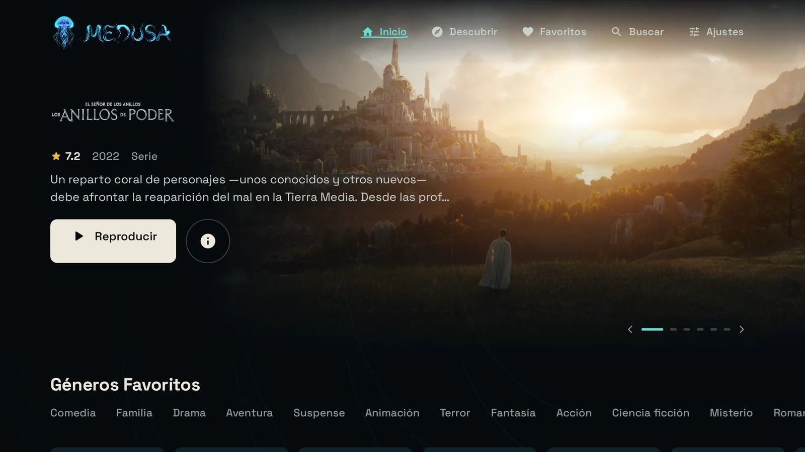
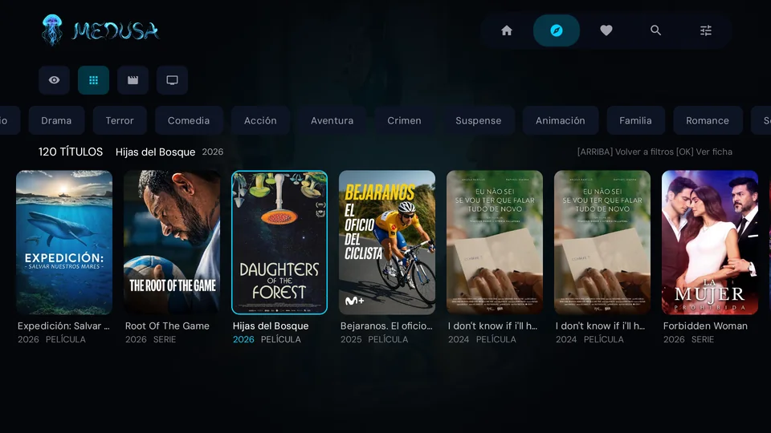
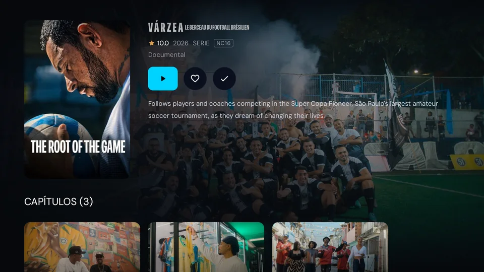
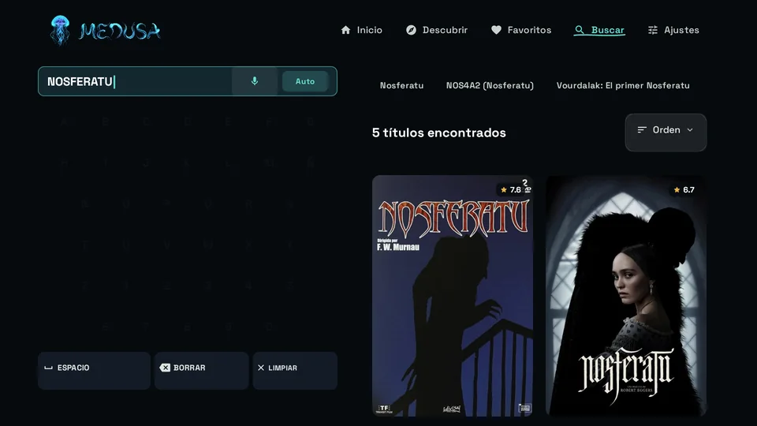
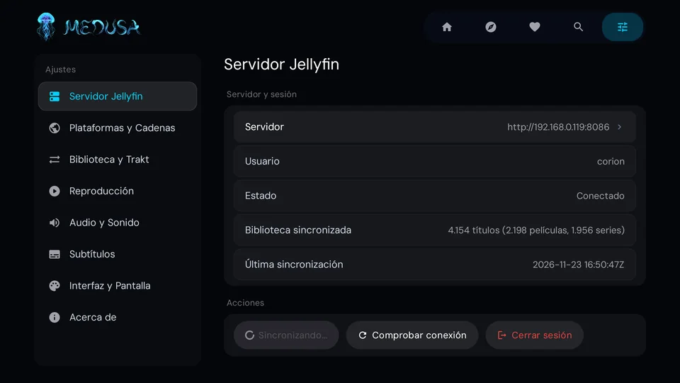

<div align="center">
  
  <p>Cliente nativo de Jellyfin para Android TV y tablet, desarrollado en Kotlin y Compose TV.</p>

  [](https://github.com/GitCorion/Medusa/releases)
  [](#requisitos)
  [](https://kotlinlang.org)
  [](https://developer.android.com/training/tv/use-apis/compose)
  [](LICENSE)

  <p>
    <a href="https://github.com/GitCorion/Medusa/releases/latest/download/Medusa.apk"><strong>Descargar APK</strong></a>
    &nbsp;·&nbsp;
    <a href="https://gitcorion.github.io/Medusa/"><strong>Sistema de diseño</strong></a>
    &nbsp;·&nbsp;
    <a href="README.en.md">English</a>
  </p>
</div>



**Contenido:** [Descripción](#descripción) · [Ecosistema](#ecosistema) · [Funcionalidades](#funcionalidades) · [Instalación](#instalación) · [Configuración](#configuración) · [Capturas](#capturas) · [Arquitectura](#arquitectura) · [Compilación](#compilación) · [Documentación](#documentación) · [Seguridad](#seguridad-y-privacidad) · [Problemas frecuentes](#problemas-frecuentes)

## Descripción

Medusa TV es un cliente nativo de Jellyfin pensado para usar con mando a
distancia en televisores (Android TV / Google TV / Fire TV) y en tablet.
Sincroniza el catálogo de tu servidor Jellyfin en una base local (Room) para
navegar con fluidez sin depender de la latencia de red en cada desplazamiento.

- **Compatibilidad:** Android 8.0+ (API 26).
- **Canales OTA:** estable y beta, seleccionables desde **Ajustes → Acerca de → Canal**.

## Ecosistema

Medusa es un cliente independiente para cualquier biblioteca de Jellyfin. Si
además utilizas [TOD](https://github.com/GitCorion/TOD) para reproducir
contenido bajo demanda mediante ficheros `.strm`, el plugin para Jellyfin permite
mostrar el estado de descarga, iniciar la preparación y negociar versiones
compatibles:

| Pieza | Rol | Cuándo hace falta |
|---|---|---|
| [Medusa](https://github.com/GitCorion/Medusa) (este repositorio) | Cliente nativo para Android TV y tablet. Reproduce desde Jellyfin. | Siempre |
| [Medusa-Jellyfin-Plugin](https://github.com/GitCorion/Medusa-Jellyfin-Plugin) | Puente Jellyfin↔TOD: estado, preparación, lease y negociación de versiones. | Solo si usas TOD |
| [TOD](https://github.com/GitCorion/TOD) | Biblioteca bajo demanda: releases, cola de qBittorrent, `.strm` y streaming por rangos. | Solo para contenido bajo demanda |

```text
Medusa TV ──▶ Jellyfin ──▶ plugin Medusa ──▶ TOD :8773 ──▶ qBittorrent
                                                             ├── Prowlarr / Jackett
                                                             └── Radarr / Sonarr (API)
```

Medusa no se comunica directamente con TOD: todas las peticiones pasan por
Jellyfin para mantener la transcodificación, los subtítulos y el progreso de
visionado. El detalle del flujo está en [`docs/PLAYBACK.md`](docs/PLAYBACK.md).

## Funcionalidades

| Área | Detalle |
|---|---|
| **Inicio** | Cabecera con ClearLogo, géneros favoritos, plataformas, Continuar viendo, Top 10 y carruseles por género. |
| **Descubrir** | Filtros de formato (todo, catálogo, películas, series) y rail de temáticas combinables (`AND`; `BACK` deshace el último filtro). |
| **Búsqueda** | Teclado adaptado al mando, sugerencias locales y búsqueda remota en Jellyfin. |
| **Ficha** | Póster, metadatos, sinopsis, progreso/favoritos, temporadas y episodios, sagas y recomendaciones. |
| **Reproductor** | Media3 + FFmpeg. DirectPlay, remux, HLS y transcodificación; `.strm`; preparación con TOD; subtítulos; pistas de audio; passthrough HDMI; siguiente episodio; Media Segments y cambio automático de tasa de refresco. |
| **Biblioteca e integraciones** | Room 22 con FTS, caché local, filtros parentales, sincronización incremental, Trakt, TMDB (con clave propia) y actualizaciones OTA desde GitHub Releases. |
| **Personalización** | Colores de acento (cian/ámbar/blanco), modo monocromo, estilos de botón, partículas opcionales, tamaño/fondo de subtítulos y reducción de movimiento. |

## Instalación

### Requisitos

- Android 8.0 o superior (API 26).
- Un servidor Jellyfin accesible en red local o por Internet.
- ~15 MB de espacio libre para el APK.

### Desde GitHub Releases

1. Descarga `Medusa.apk` desde [la última release](https://github.com/GitCorion/Medusa/releases/latest).
2. Habilita la instalación de orígenes desconocidos en el dispositivo si es necesario.
3. Abre el APK para instalarlo.

También puedes instalarlo por ADB:

```bash
adb install -r Medusa.apk
adb shell am start -n tv.medusa.app/tv.medusa.app.MainActivity
```

> El `applicationId` es `tv.medusa.app` desde la versión 2.4.0. La build 2.3.12
> usaba `tv.medusa.app.beta`; si vienes de esa versión, desinstálala tras
> instalar la nueva (Android las trata como aplicaciones distintas).

### Actualizaciones OTA

En cada arranque, la app consulta [`docs/api/version.json`](docs/api/version.json).
Si hay una versión nueva, descarga `Medusa.apk` desde GitHub Releases, verifica
el hash **SHA-256**, el tamaño y el origen antes de lanzar el instalador. Si el
manifiesto no puede verificarse durante siete días, se bloquea la actualización
hasta obtener una respuesta válida.

Los canales **estable** y **beta** se cambian en **Ajustes → Acerca de → Canal**;
detalles en [`docs/RELEASE.md`](docs/RELEASE.md).

## Configuración

La configuración se realiza directamente desde **Ajustes**:

1. **Servidor:** busca instancias de Jellyfin en la red local o permite
   introducir la URL manualmente (incluidas subrutas como `https://host/jellyfin`).
   Para certificados autofirmados es necesario fijar su huella SHA-256.
2. **Sesión:** inicio de sesión con usuario/contraseña o mediante **Quick Connect**.
3. **Sincronización:** la primera pasada indexa el catálogo en Room; las
   posteriores son incrementales mediante WorkManager.
4. **Integraciones opcionales:** región y plataformas en **Plataformas y cadenas**;
   Trakt y clave propia de TMDB en **Biblioteca y Trakt**.

## Capturas

<p align="center">
  
  
</p>
<p align="center">
  
  
</p>

## Arquitectura

Aplicación de actividad única con Navigation Compose y estado por pantalla.
`MediaRepository` coordina repositorios especializados (local, Jellyfin,
sincronización, TMDB y Trakt) sobre Room 22 + FTS, almacenamiento cifrado con
Android Keystore y tareas en segundo plano con WorkManager.

La resolución de fuentes de vídeo vive en `JellyfinPlaybackSourceResolver`,
`PlayerViewModel` y `PlayerScreen`, cubiertos por tests unitarios. Más detalles
en [`docs/ARCHITECTURE.md`](docs/ARCHITECTURE.md) y [`docs/PLAYBACK.md`](docs/PLAYBACK.md).

## Compilación

### Requisitos

- JDK 17.
- Android SDK 36 (`compileSdk = 36`, `targetSdk = 36`).

```bash
git clone https://github.com/GitCorion/Medusa.git
cd Medusa
./gradlew :app:assembleDebug
```

El APK de depuración se genera en `app/build/outputs/apk/debug/app-debug.apk`.

### Tests y lint

```bash
./gradlew :app:testDebugUnitTest
./gradlew :app:lintDebug
./gradlew :app:connectedDebugAndroidTest   # migraciones de Room, requiere dispositivo
```

### Release firmado

Las credenciales de firma no se versionan. Pueden pasarse por variables de
entorno o mediante `keystore.properties`:

```bash
KEYSTORE_PATH=/ruta/release.keystore \
KEYSTORE_PASSWORD=... \
KEY_ALIAS=... \
KEY_PASSWORD=... \
./gradlew :app:assembleRelease
```

Variable opcional en tiempo de compilación: `TRAKT_CLIENT_ID`. Tanto
`TRAKT_CLIENT_SECRET` como la API key de TMDB se configuran en Ajustes. El flujo
de publicación por tags está documentado en [`docs/RELEASE.md`](docs/RELEASE.md).

## Documentación

| Documento | Contenido |
|---|---|
| [Sistema de diseño (web)](https://gitcorion.github.io/Medusa/) | Demostración interactiva de foco, tokens, capturas y decisiones visuales. |
| [`docs/ESTUDIO.md`](docs/ESTUDIO.md) | Versión en Markdown del sistema de diseño y deuda visual. |
| [`DESIGN.md`](DESIGN.md) | Tokens, tipografía, estructura, movimiento y reglas de interfaz. |
| [`PRODUCT.md`](PRODUCT.md) | Alcance y decisiones de producto. |
| [`docs/ARCHITECTURE.md`](docs/ARCHITECTURE.md) | Capas, flujos, cachés, workers y pruebas. |
| [`docs/PLAYBACK.md`](docs/PLAYBACK.md) | Orden de candidatos, `DeviceProfile`, audio, subtítulos e invariantes. |
| [`docs/RELEASE.md`](docs/RELEASE.md) | Publicación en GitHub Releases, OTA y firma. |
| [`docs/CATALOGS.md`](docs/CATALOGS.md) | Catálogos estáticos de descubrimiento por región. |
| [`CONTRIBUTING.md`](CONTRIBUTING.md) | Entorno, estilo, pruebas y guía de PR. |
| [`SECURITY.md`](SECURITY.md) | Política de seguridad y reporte de vulnerabilidades. |
| [`CHANGELOG.md`](CHANGELOG.md) | Historial de cambios recientes. |

## Seguridad y privacidad

La aplicación no incluye telemetría ni SDKs de terceros de analítica o
publicidad. Las únicas conexiones de red son:

- **Tu servidor Jellyfin** (y el plugin Medusa si utilizas TOD).
- **GitHub** para comprobación de actualizaciones OTA y catálogos estáticos opcionales.
- **TMDB**, **Trakt** o **YouTube nocookie**, únicamente si configuras las integraciones o abres un tráiler.

Las credenciales locales se cifran con AES/GCM mediante Android Keystore, los
certificados autofirmados usan *pinning* SHA-256 y las actualizaciones OTA exigen
verificación SHA-256 y origen en GitHub (`150 MB` máximo). Consulta [`SECURITY.md`](SECURITY.md)
antes de reportar un fallo de seguridad.

## Problemas frecuentes

| Síntoma | Comprobación |
|---|---|
| No detecta el servidor | Verifica que dispositivo y servidor estén en la misma red y que el firewall no bloquee el descubrimiento; introduce la URL manualmente. |
| Error de certificado | Activa certificados autofirmados para ese servidor y fija su SHA-256. |
| Un `.strm` no inicia | Comprueba que el televisor no intenta resolver una IP interna del servidor y revisa [`docs/PLAYBACK.md`](docs/PLAYBACK.md). |
| Audio DTS/TrueHD sin sonido | Habilita passthrough HDMI si tu equipo lo soporta o deja que Jellyfin transcodifique. |
| Sin subtítulos | Comprueba que la pista exista en el `MediaSource` y que el endpoint de subtítulos responda. |
| La actualización OTA no aparece | Verifica que el `versionCode` sea superior y que `Medusa.apk` esté adjunto en la release. |
| Tirones en hardware lento | Desactiva partículas opcionales y evita forzar transcodificación 4K en el servidor. |

Para reportar incidencias, abre un [issue](https://github.com/GitCorion/Medusa/issues)
indicando modelo de dispositivo, versión de Android, versión de la app y versión
de Jellyfin (sin incluir tokens ni IPs privadas).

## Contribuir

1. Revisa [`CONTRIBUTING.md`](CONTRIBUTING.md).
2. Ejecuta `./gradlew :app:testDebugUnitTest` y `./gradlew :app:lintDebug`.
3. Respeta las invariantes de reproducción de [`docs/PLAYBACK.md`](docs/PLAYBACK.md) y actualiza `values/strings.xml` y `values-en/strings.xml`.

Formato de commits: convencional en español (por ejemplo, `fix(player): reintentar audio sin perder la posición`).

## Licencia y créditos

Medusa TV se distribuye bajo **GNU General Public License v3.0** ([`LICENSE`](LICENSE)).
[Medusa-Jellyfin-Plugin](https://github.com/GitCorion/Medusa-Jellyfin-Plugin)
(GPL-3.0) y [TOD](https://github.com/GitCorion/TOD) (MIT) son proyectos
independientes del mismo ecosistema.

Construido con [Jellyfin](https://jellyfin.org), [Android Media3](https://developer.android.com/media/media3),
[Kotlin](https://kotlinlang.org), [Jetpack Compose](https://developer.android.com/compose),
[Hilt](https://dagger.dev/hilt/), [Room](https://developer.android.com/training/data-storage/room),
[Coil](https://coil-kt.github.io/coil/), [Retrofit](https://square.github.io/retrofit/),
[OkHttp](https://square.github.io/okhttp/) y [WorkManager](https://developer.android.com/topic/libraries/architecture/workmanager).

*This product uses the TMDB API but is not endorsed or certified by TMDB.*
DM Sans se distribuye bajo SIL Open Font License.
